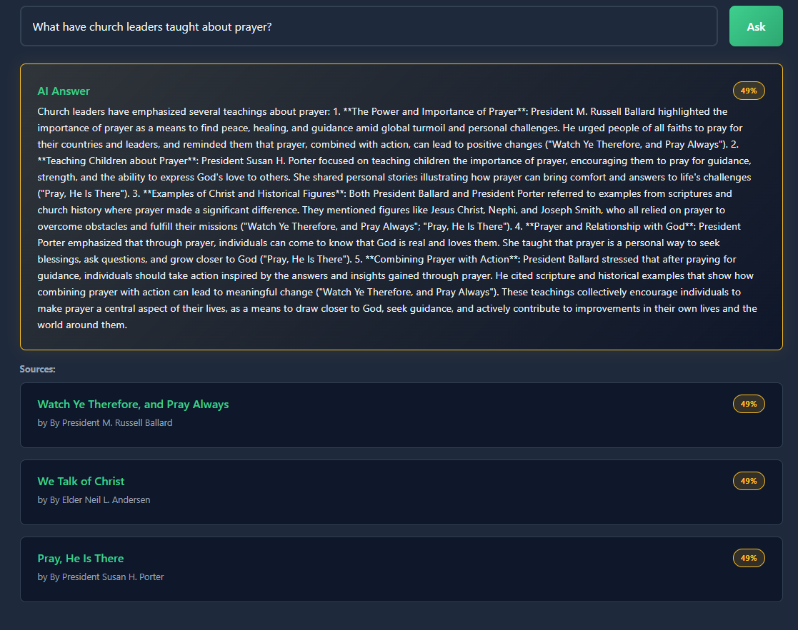

# Conference RAG Submission

## 1. GitHub repository

https://github.com/egriffioen/conference-rag

## 2. Live deployment

https://egriffioen.github.io/conference-rag/

## 3. Screenshot of a working RAG query

## 4. Custom feature: HyDE toggle

> Describe what you added and why.

So HyDE basically takes a question, gives it to ChatGPT to find a general answer and uses the answer and its embedding to find what talks are closest to it. Earlier we noticed that the question and its answer weren't super close when we computed the distance. We thought this method might be able to help (although of course it's a bit risky to ask AI to find its own solution first). There is now a checkbox under semantic search and RAG that will implement HyDE, so you can turn it on and off. It shows you the fake answer that AI gave (what it actually used to compute the distance between embeddings). We ran an experiment though, and HyDE did not improve performance. Its answers were vague and had common general conference phrases and wording, so it was no longer able to find more specific talks with the right key words. So while HyDE might work in some circumstances, it overall did not work super well here.

## 5. Reflection

### 1. Security architecture

> Draw or describe a diagram showing what protects each sensitive asset in this application. Your answer should address:
> - Why is the anon key safe to expose in `config.public.json`?
> - What would happen if someone got the service role key?
> - How do Edge Functions protect the OpenAI API key?
> - What role does Row Level Security play?

| Sensitive asset | Where it lives | What protects it |
|---|---|---|
| Conference sentence data | Supabase Postgres | RLS: only `authenticated` users can read it. Anonymous reads silently return 0 rows. No one can insert, update, or delete rows except the service role. |
| page_views table | Supabase Postgres | RLS: anyone can read and add views, but no policy allows updates or deletes, so no one can change or remove them. |
| anon key | `config.public.json` (public) | Nothing hides it. RLS determines what the key can do, so anyone unauthenticated has limited capacity. |
| service_role key | `config.secret.json` (git-ignored) | `.gitignore` makes sure it's never committed, and it is only used by the Python scripts on my machine, never in the browser code. |
| OpenAI API key | Supabase secrets | Supabase keeps it in its secrets storage, so it never reaches the browser or GitHub. Edge Functions make it possible to still use it, and they verify the user's JWT first, so strangers can't spend my credits. |
| User sessions (JWTs) | The user's browser | Supabase is the only one who can create and sign the JWTs, so they can't be forged. If one is stolen, it expires in about an hour. |

RLS automatically does the role authorization on the tables for us. Everyone gets the anon role at the start and can only access specific tables. Other tables become available if you are logged in. If someone took the anon key from `config.public.json` and tried to read the conference data or delete page views, they would run into RLS, which prevents those actions because they are not authenticated or authorized to do them. If someone found the service_role key, they would have that access, because it bypasses RLS and has the admin ability to change or delete anything in any table.

The anon key is public and applies to literally anyone, authenticated or unauthenticated, so it doesn't really matter that it's exposed, since RLS will limit what anon can do. My session JWT confirms me as me and has an added layer of authorization, so we need to be a lot more careful about an active, authenticated session. Supabase produces the signed JWT and is the only one who can do that.

Edge Functions protect the OpenAI API key because the key is only used on the Supabase servers and is never in deployed JavaScript code.

### 2. Edge Functions and the "secure middle"

> Why can't we call OpenAI directly from the browser? Explain the flow: browser → Edge Function → OpenAI. What role does JWT verification play in this chain? How does this pattern apply to other production applications?

We can't put the OpenAI key in the browser, because a user can access the inspector tools and see it come together at runtime on their machine. Instead, app.js makes the request, it triggers the Edge Function that Deno runs on the Supabase server (which then calls OpenAI), and the function returns the response to app.js. The OpenAI key only lives on the server.

The JWT, which only Supabase can sign, is what keeps the Edge Function safe from someone using curl to call it. CORS is a separate thing: it keeps users safe in the browser from other websites. The order of the checks matters too. If we called OpenAI before validating input, we could be sending bad or malicious input (one that would use a ton of tokens, for example) to OpenAI.

This applies to production applications for times when you need functions to run that use keys that need to be protected (such as these OpenAI keys --> so many production websites have AI chatbots on their sites, and are probably using APIs like this)

### 3. From SQL to semantics

> Compare keyword search (SQL `ILIKE`) vs semantic search (vector cosine similarity):
> - When would each be better?
> - Give a specific query example where one succeeds and the other fails
> - What makes semantic search "understand" meaning?

With keyword search, misspelled words like "fath" (instead of "faith") usually connected more with "father," and "cahrity" (instead of "charity") just didn't bring up anything. Concepts were only found if the wording was exact: one talk has "feeling sad," none have "feeling bad." With semantic search, the embeddings with the smallest distance are closest together semantically, so "feeling bad" brought up a lot more results, but it didn't help as much with the misspellings.

Keyword search is better for something like "Liahona," because it is literally one word; we aren't trying to get the meaning of a phrase or sentence. Semantic search is better for something like "dealing with the death of a parent," because it is a lot less likely that those specific words are used, but more likely that those ideas are discussed. A query like "talks that say there is no forgiveness" is a trap for both because of the negation.

Semantic search can understand the meaning because of the embeddings. Those vectors represent concepts and ideas, and similar vectors have similar meanings.

### 4. RAG vs fine-tuning

> We used RAG instead of fine-tuning a model on conference talks. Research what fine-tuning is. Then explain:
> - What are the trade-offs between RAG and fine-tuning?
> - Why did we choose RAG for this application?
> - When might fine-tuning be the better choice?

Right now, to add a new conference, I would just scrape the new data and add it to the database, and then any of those talks would be able to match with RAG. If I fine-tuned, I'd have to go through hours of training again, at a higher cost. RAG is much better with facts and recent information. RAG also allows for much more accurate citations because the AI is drawing from a specific source. The sources used for fine-tuning get lost in the weigts and can't really be traced back in the way that RAG can.

RAG can still be wrong, though. If it hasn't been given the most up-to-date data (we don't have 2026 in our database), it can't answer from it. And the answers can still be misleading, like in the temple-counting test, where the talk was labeled without a date and the answer used the date from my question.

Fine-tuning is when you actually change the weights in the LLM through training the LLM on data. Fine-tuning is a better choice when you need a lot of generalized data in a domain and a specific tone and way of answering, and you don't have a current model that can fit the bill. 

### 5. AI-assisted development

> Briefly describe how your AI coding assistant helped you during this assignment:
> - What did it do well?
> - Where did you need to guide it?
> - What did you learn about working with AI tools?

The AI seemed to believe that the HyDE method would be better, since statements and questions have different embeddings, but after the experiment I learned that for these conference talks, search performed better without it. While the underlying concept makes sense and might work in other circumstances, we realized it didn't work here, likely because it made the answers too "general conferencey". I also learned about different semantic search methods, and I am finally understanding what Deno and Supabase are and what that process looks like. I learned that AI tools are helpful, especially with not having to worry about boilerplate code, and teaching me along the way. It is also nice to be able to do experiments with different methods because it's so much faster to get the code written.
